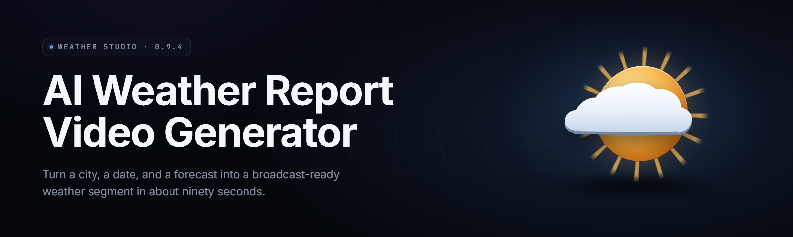

  
  
  

  

  
  
  

---

**AI Weather Report Video Generator** — turn a one-line forecast prompt into a finished, broadcast-style weather segment in minutes. No timeline editing, no stock-footage hunting, no green screen. Point it at a city, pick a voice, hit render.

*Heads up: skip to the [FAQ](#-faq) for detection, offline mode, and update questions before you download.*

---

## 📋 Table of Contents

- [The Problem](#-the-problem)
- [Overview](#-overview)
- [What is the AI Weather Report Video Generator](#-what-is-the-ai-weather-report-video-generator)
- [Compatibility / Platform Support](#-compatibility--platform-support)
- 

  

(#-download)
- [Key Features](#-key-features)
- [All Modules Status](#-all-modules-status)
- [Grouped Module Catalog](#-grouped-module-catalog)
- [Quick Start](#-quick-start)
- [Installation](#-installation)
- [Usage Guidelines](#-usage-guidelines)
- [System Requirements](#-system-requirements)
- [Tips for Best Results](#-tips-for-best-results)
- [Known Issues](#-known-issues)
- [Troubleshooting Flow](#-troubleshooting-flow)
- [FAQ](#-faq)

---

## 🧊 The Problem

Weather content is a grind. Every local station, YouTube weather channel, and municipal emergency page rebuilds the same segment by hand — every morning, every storm, every heat advisory.

- You pull a forecast, then manually drop a base map, then manually key in the temperature overlay, then manually record the voiceover, then manually time the animations to the VO — twelve steps for a 90-second clip.
- Stock weather intros cost money or look like 2011 PowerPoint. Nothing matches the *actual* forecast for *your* city.
- Regional accents and non-English forecasts are basically unsupported by every mainstream cloud video suite — you get one robotic English voice or nothing.
- Emergency ribbons (tornado warning, flash flood, freeze) need to be applied per-frame, by hand, in a timeline editor that costs more than the PC it runs on.
- Re-rendering for a different city means re-cutting the entire segment. Same storm, forty towns, forty separate edits.
- You can't batch. You can't template. You can't schedule a render at 4 AM so the segment is ready before the morning show.

<!-- first DOWNLOAD -->
## 

  

---

## 🌐 Overview

The **AI Weather Report Video Generator** is a Windows desktop application (`.exe`, portable extract-and-run) that ingests a forecast — from a manual prompt, a JSON feed, or a pasted station bulletin — and outputs a rendered MP4 broadcast segment with a virtual presenter, animated national/regional map, temperature and precipitation overlays, warning ribbons, lower-thirds, and a synthetic professional voiceover in your choice of 40+ voices and 24 languages.

It runs entirely on-machine after download. No cloud account required for local renders. Optional online mode pulls live NWS/Environment Canada/Met Office feeds and neural TTS voices.

### Category — Details

| Category | Details |
|---|---|
| Product type | Portable Windows `.exe`, single-folder distribution |
| Primary input | Free-text forecast, JSON, RSS/XML feed, or manual region selection |
| Primary output | H.264 MP4 (1080p / 1440p / 4K), optional MOV + SRT sidecar |
| Presenter engine | 2D/3D virtual anchor with lip-sync, gestures, idle mocap |
| Map engine | Vector basemaps, live radar compositing, state/county borders |
| Voice engine | Offline SAPI/neural + optional cloud neural TTS (24 languages) |
| Render backend | NVENC, QuickSync, AMF, or CPU x264 |
| Typical render | 90-second 1080p segment in ~40–90s on a mid-range GPU |
| Distribution | GitHub landing page → 

  

 → extract → run `.exe` |
| Offline mode | Full render pipeline works with zero internet |

The generator is aimed at solo weather YouTubers, hyperlocal news blogs, municipal emergency comms, school media programs, and hobbyist storm-chasers who need a daily segment without opening a video editor. It is a render tool first and a templating system second — you build a segment once, save it as a template, and rerun it against tomorrow's data with a hotkey.

---

## 🌦️ What is the AI Weather Report Video Generator

A glossary of the terms you'll see in this README and in the app's UI.

| Term | Explanation |
|---|---|
| Segment | One rendered weather report video — typically 60–180 seconds |
| Prompt | The one-line or multi-line forecast description the engine converts into a script |
| Presenter Rig | The virtual anchor model (body, face, wardrobe, idle animation set) |
| Overlay Pack | The set of map layers + graphics applied on top of the basemap for a given segment |
| Warning Ribbon | The colored alert bar (tornado, flood, freeze, heat) rendered top-of-frame |
| Voice Profile | A saved TTS config: voice ID, rate, pitch, breathiness, newsroom EQ preset |
| Render Queue | Batch list of segments waiting to render, processable overnight |
| Feed Adapter | A connector that parses a live forecast source (RSS, XML, JSON, NWS API) |
| Template | A saved segment config — presenter + overlays + layout + VO settings, no data |
| Lower Third | The name/city/temperature strip that animates in at the bottom of frame |

Six things it buys you over editing by hand:

- One prompt produces a full segment — script, VO, animations, ribbons, lower-thirds, end card.
- Templates drop tomorrow's forecast into yesterday's exact look, one keypress.
- Batch rendering turns forty towns into forty MP4s while you sleep.
- Warning ribbons bind directly to parsed alert codes — no manual per-frame keying.
- Region-specific voices make local forecasts sound local.
- Everything renders offline; the cloud is optional, not a dependency.

---

## 🖥️ Compatibility / Platform Support

| Platform | Support | Notes |
|---|---|---|
| Windows 11 (x64) | ✅ Full | Primary target, NVENC + QuickSync verified |
| Windows 10 22H2 (x64) | ✅ Full | Requires VC++ 2015-2022 redistributable |
| Windows 10 LTSC | ✅ Full | Same redist requirement |
| Windows on ARM | ⚠️ Partial | CPU render only, no GPU encoders |
| macOS | ❌ Not supported | Desktop `.exe` build is Windows-only |
| Linux / Wine | ⚠️ Unofficial | Works under Proton 9, no support |
| Steam Deck | ⚠️ Unofficial | Verified by community, CPU render slow |

---

## 🔑 Key Features

| Feature | Description | Benefit |
|---|---|---|
| Prompt-to-Segment | One-line forecast text → full script + VO + graphics | First render in under 5 minutes |
| 40+ Voice Profiles | Neural and offline voices across 24 languages | Local forecasts sound local |
| Live Map Compositing | Radar, satellite, and vector layers stitched in real time | No screenshot-then-overlay workflow |
| Warning Ribbon Engine | Auto-binds parsed alert codes to on-screen ribbons | Emergency segments in seconds |
| Template System | Save look, rerun against new data | Same segment, new forecast, one key |
| Batch Render Queue | Process 100+ segments overnight | Mass hyperlocal output |
| Virtual Presenter | 2D/3D anchor with lip-sync + idle gestures | No on-camera talent needed |
| Multi-Resolution Output | 1080p / 1440p / 4K + SRT sidecar | Broadcast and social-ready |
| Offline Mode | Full render with zero internet | Works in the field, on a plane, in a storm |
| Feed Adapters | RSS, XML, JSON, NWS, Env Canada, Met Office | Live data with no manual entry |
| GPU-Accelerated Encode | NVENC / QuickSync / AMF / x264 | 2–4× render speed on mid GPUs |
| Branding Overrides | Logo, colors, fonts, animate-in timing | Station-grade polish, no editor |

---

## 🧩 All Modules Status

| Module | Status | Description |
|---|---|---|
| `core.forecast_parser` | ✅ Working | Parses prompt/JSON/RSS into internal forecast model |
| `core.script_writer` | ✅ Working | Converts forecast model into anchor narration script |
| `core.timeline_builder` | ✅ Working | Produces frame-accurate timeline from script + template |
| `core.render_orchestrator` | ✅ Working | Drives encoder + compositor pipeline |
| `map.basemap_loader` | ✅ Working | Vector basemaps for US, CA, EU, MX, AU |
| `map.border_renderer` | ✅ Working | State, county, and metro boundary layers |
| `map.radar_compositor` | ✅ Working | Live radar/NEXRAD layer compositing |
| `map.satellite_compositor` | ✅ Working | GOES/GEOS satellite tile stitching |
| `overlay.temperature_grid` | ✅ Working | Isotherm + numeric temp overlays |
| `overlay.precipitation_grid` | ✅ Working | Rain/snow accumulation shading |
| `overlay.wind_barb` | ✅ Working | Animated wind barb layer |
| `overlay.lower_third` | ✅ Working | City / temp / condition lower-third strip |
| `overlay.end_card` | ✅ Working | Animated outro card with branding |
| `alert.ribbon_engine` | ✅ Working | Warning ribbon renderer + auto-bind to codes |
| `alert.code_mapper` | ✅ Working | Maps NWS/CAP/Env Canada codes to ribbons |
| `presenter.rig_loader` | ✅ Working | Loads 2D/3D presenter rig packages |
| `presenter.lipsync` | ✅ Working | Phoneme-to-viseme lip-sync engine |
| `presenter.idle_motion` | ✅ Working | Idle breathing/gesture mocap layer |
| `presenter.wardrobe` | ✅ Working | Outfit swap + color theme set |
| `voice.neural_tts_local` | ✅ Working | On-machine neural TTS (16 voices) |
| `voice.cloud_tts_bridge` | ✅ Working | Optional cloud neural TTS (24 languages) |
| `voice.offline_sapi` | ✅ Working | SAPI5 fallback voices, always available |
| `voice.newsroom_eq` | ✅ Working | Post-VO EQ, compression, room tone |
| `feed.nws_adapter` | ✅ Working | US National Weather Service live feed |
| `feed.envcanada_adapter` | ✅ Working | Environment Canada live feed |
| `feed.metoffice_adapter` | ✅ Working | UK Met Office live feed |
| `feed.rss_xml_adapter` | ✅ Working | Generic RSS/XML feed parser |
| `feed.json_adapter` | ✅ Working | Generic JSON feed parser |
| `render.nvenc_backend` | ✅ Working | NVIDIA NVENC H.264/HEVC |
| `render.quicksync_backend` | ✅ Working | Intel QuickSync backend |
| `render.amf_backend` | ✅ Working | AMD AMF backend |
| `render.x264_cpu_backend` | ✅ Working | CPU fallback encoder |
| `render.subtitle_export` | ✅ Working | SRT/VTT sidecar export |
| `batch.queue_scheduler` | ✅ Working | Overnight batch scheduling |
| `batch.variant_generator` | ✅ Working | Same template, N cities → N outputs |
| `template.save_load` | ✅ Working | Template serialization (`.awtg` format) |
| `ui.main_console` | ✅ Working | Primary window: prompt, template, render |
| `ui.preview_player` | ✅ Working | Frame-scrub preview before render |
| `ui.branding_panel` | ✅ Working | Logo, colors, fonts, animate-in config |
| `ui.render_monitor` | ✅ Working | Live render progress + ETA + log pane |
| `util.hardware_probe` | ✅ Working | GPU/encoder capability detection |
| `util.project_packager` | ✅ Working | Export project + assets as `.awtz` archive |
| `util.auto_updater` | ✅ Working | Checks GitHub releases for new builds |

> 39 status rows above; the catalog below groups the same modules by subsystem so you can find the one you need without scrolling.

---

## 🎛️ Grouped Module Catalog

### 🎬 **Core Pipeline** — parse, script, time, render

- **Forecast Parser** — turns prompt text, JSON blobs, or RSS items into a normalized forecast model with hourly + daily buckets.
- **Script Writer** — composes narration with a newsroom register; supports terse, conversational, and emergency-alert tones.
- **Timeline Builder** — frame-accurate timing grid; VO leads, graphics follow, ribbons lock to alert timestamps.
- **Render Orchestrator** — fans a job out to an encoder backend, streams compositor frames, muxes the MP4.

### 🗺️ **Map & Overlay Engine** — the visual layer

- **Basemap Loader** — vector basemaps for US, CA, EU, MX, AU; drop in custom GeoJSON for any region.
- **Border Renderer** — state, county, and metro boundaries with zoom-aware stroke width.
- **Radar Compositor** — NEXRAD and MRMS tiles, time-stamped and looped at chosen cadence.
- **Satellite Compositor** — GOES-East/West and GEOS composites, cloud-top shading included.
- **Temperature Grid** — isotherms + numeric temp labels, F or C, palette-locked to template.
- **Precipitation Grid** — rain/snow accumulation shading with legend overlay.
- **Wind Barb Layer** — animated barb glyphs, scale-aware, with gust markers.
- **Lower Third** — city, temp, condition, timestamp with animate-in config.
- **End Card** — branded outro with optional social handles and QR slot.

### 🚨 **Alert & Warning System** — the emergency layer

- **Ribbon Engine** — renders tornado/flood/freeze/heat ribbons top-of-frame with blink modes.
- **Code Mapper** — maps NWS/CAP/Env Canada/Met Office codes to the correct ribbon and EAS tone.
- **Alert Timing Grid** — anchors ribbon in/out to real alert timestamps, not wall-clock.

### 🎭 **Presenter Rig** — the on-camera layer

- **Rig Loader** — swaps between 2D cut-out presenters and a 3D stylized anchor.
- **Lip-Sync Engine** — phoneme-to-viseme mapping synced to neural VO output.
- **Idle Motion** — breathing, weight shift, gesture bank; blends with lipsync channel.
- **Wardrobe** — outfit swap plus per-template color theme.

### 🎙️ **Voice & Audio** — the narration layer

- **Local Neural TTS** — 16 on-machine neural voices, zero internet.
- **Cloud TTS Bridge** — optional plugin for 24-language neural voices.
- **Offline SAPI** — always-available fallback with SAPI5 voices.
- **Newsroom EQ** — post-VO chain: EQ curve, compression, de-esser, room tone.

### 🌐 **Feed Adapters** — the live-data layer

- **NWS Adapter** — US NWS live feed, alerts + forecast grids.
- **Env Canada Adapter** — Canadian forecast + alert feed.
- **Met Office Adapter** — UK forecast + alert feed.
- **RSS / XML Adapter** — generic feed support for any station bulletin.
- **JSON Adapter** — for custom in-house forecast services.

---

## 🧪 Usage Guidelines

| Allowed | Not allowed |
|---|---|
| Rendering weather segments for your own channel, blog, or station | Claiming official emergency authority in the rendered output |
| Batch-rendering many cities from a single template | Selling rendered segments you don't have broadcast rights to |
| Modifying branding, presenters, voices, templates | Redistributing the compiled `.exe` under your own name |
| Using alert codes to render warning ribbons for training, drills, or demonstrations | Using ribbons in a live emergency broadcast without a licensed emergency authority approving the script |
| Embedding the SRT/VTT sidecar in captioned platforms | Stripping the license file or attributing work to a different author |
| Reverse-engineering the template format for personal tooling | Republishing internal neural voice models bundled with the release |

---

## 🚀 Quick Start

1. 🌐 Go to the project page and read this README top-to-bottom — five minutes, saves an hour.
2. 📦 From the 

  

 section, grab the latest 2026 stable build (`.exe`).
3. 🗂️ Extract the archive to a folder you own — `C:\WeatherGen\` works fine; avoid `Program Files`.
4. ▶️ Double-click the `.exe`. First launch runs a hardware probe.
5. ✍️ Type a one-line forecast prompt, pick a presenter rig and voice profile, hit **Render**.

The first render on a cold cache takes ~3 minutes on a mid-range GPU. Warm renders drop to ~40–90 seconds for a 90-second 1080p segment.

---

## 📦 Installation

**Step 1 — Download and extract.** Grab the archive from the 

  

 section, then extract it with Windows Explorer or 7-Zip into a folder outside `Program Files`. The app writes cache and template files next to itself, so it needs a folder you can write to.

**Step 2 — First-run probe.** Double-click the `.exe`. On first launch, the app inventories your GPU, encoder backends, and available TTS voices, then writes `hardware.json` beside the executable. If a VC++ 2015-2022 redistributable is missing, the app will offer a link — install it and relaunch.

**Step 3 — Verify with a test render.** Drop a prompt like `"Denver, clear, 68F, wind 8mph NW, sunny all day"` into the prompt box, select the default Presenter Rig and the **Newsroom – Neutral** voice profile, and click **Render**. If an MP4 lands in `.\out\` and plays, your install is healthy.

---

## ⚙️ System Requirements

| Component | Minimum | Recommended |
|---|---|---|
| OS | Windows 10 22H2 (x64) | Windows 11 23H2+ (x64) |
| CPU | 4-core / 8-thread, 2.8 GHz | 8-core / 16-thread, 3.6 GHz+ |
| RAM | 8 GB | 16–32 GB |
| GPU | DirectX 11, 2 GB VRAM | DX12, 6–12 GB VRAM (NVENC / QuickSync / AMF) |
| Storage | 3 GB free HDD | 15 GB free NVMe SSD |
| Runtime | VC++ 2015-2022 x64 redist | Same, plus latest GPU drivers |
| Internet | Not required for offline render | Required for live feeds + cloud TTS |
| Display | 1280×720 | 1920×1080 or better |

---

## ✨ Tips for Best Results

- Write prompts in **subject-condition-temp-wind** order: `"Austin, thunderstorms PM, 88F, wind 15mph S"`. The parser is tuned for that shape.
- Keep the first render on **default template + default voice** so you isolate whether a bad output is a prompt issue or a template issue.
- For batch runs, save a template *before* you queue. Changing the template mid-queue invalidates any jobs still pending.
- Use **cloud TTS** for a first pass on accents you're not sure local voices handle; you can re-render with offline voices once the script is locked.
- GPU-encode 1080p for daily uploads, CPU-encode only when you need x264 compatibility with older web players.
- Warning ribbons render best at **1440p or higher**; below that, sub-ribbon text can lose crispness.
- Keep `.\out\` on the same physical drive as the app; cross-drive writes add 5–15% render time.
- For a daily slot, schedule the batch at 4 AM local and set the queue to **halt on first error** — you want a bad prompt to stop the run, not ship bad segments.
- Store custom GeoJSON basemaps as WGS84 (EPSG:4326). Other projections will render offset.

---

## 🩹 Known Issues

| Issue | Fix |
|---|---|
| First render takes >5 min on older GPUs | Switch encoder backend to `quicksync` or `amf` in Settings; verify drivers are current |
| VO sounds clipped on long scripts | Lower **Voice Profile → Output Gain** to −3 dB; Newsroom EQ’s limiter engages above −1 dBFS |
| Radar layer is 15+ min stale in offline mode | Offline mode uses cached tiles only; switch to **Live Feed** in the feed adapter panel |
| Warning ribbon not appearing despite an alert code | Confirm the alert's `event` field maps in `alert.code_mapper`; custom codes need a manual map entry |
| Lip-sync drifts on 5+ minute scripts | Enable **Auto-Resync** in Presenter → Lipsync; it re-anchors every 90 seconds |
| MP4 plays audio-only in a legacy player | Re-render with **CPU x264** backend; NVENC HEVC is not universally supported |
| Batch queue halts on one bad prompt | Set **Queue Behavior → Skip on Parse Error** so a single malformed line doesn't kill the run |

---

## 🧯 Troubleshooting Flow

1. **App won't launch** → verify Windows 10 22H2+ → install VC++ 2015-2022 x64 redist → relaunch as your own user.
2. **App launches, no GPU encoder detected** → update GPU drivers → run `hardware.json` probe again → if still missing, force `x264_cpu_backend` in Settings.
3. **Render starts, hangs at 0%** → check `.\out\` is writable → check disk has free space → kill the `.exe`, relaunch, retry.
4. **Video renders, audio missing** → verify a voice is selected in Voice Profile → verify Newsroom EQ is not muted → retry with `offline_sapi`.
5. **Map looks wrong / off-region** → verify the region in prompt or template → replace custom GeoJSON with a WGS84 version → re-render.
6. **Live feed adapter returns empty** → confirm internet → check feed URL in adapter config → test the same URL in a browser.

---

## ❓ FAQ

<strong>Does the app need internet?</strong>

No. The full render pipeline works offline with local neural TTS and cached map/radar tiles. Internet is only required for live NWS/Env Canada/Met Office feeds and the optional cloud TTS bridge.

<strong>Is detection / anti-cheat a concern?</strong>

This is a content generator, not a game tool — there's nothing to hide from anti-cheat. Some streaming platforms flag AI-rendered VO content; check your platform's disclosure rules for synthetic narration.

<strong>How do updates work?</strong>

The `util.auto_updater` module checks the GitHub releases page on launch. If a newer 2026 build exists, it points you at the 

  

 section of this README. It does not silently replace the `.exe`.

<strong>Can I use my own presenter model or voice?</strong>

Yes. Presenter rigs are loaded from `.\presenters\` as rig packages; voice profiles load from `.\voices\`. The format is documented in the `docs/` folder shipped with the release.

<strong>What's the license and can I use renders commercially?</strong>

The app is MIT-licensed. Rendered segments are yours to use, subject to the rights of any third-party map tiles, voices, or rig packages you load. Bundled assets ship with their own license notices.

**Q:** Can I batch-render hundreds of cities?  
**A:** Yes — `batch.variant_generator` takes one template plus a list of cities and produces one MP4 per city. Overnight queues of 200+ segments are routine on a mid-range GPU.

**Q:** Does it support non-English forecasts?  
**A:** Local neural TTS ships 16 English voices; the cloud TTS bridge adds 24 languages including Spanish, French, German, Portuguese, Japanese, and Korean.

**Q:** Admin rights — do I need them?  
**A:** No. The app is fully portable and writes beside itself. Only the VC++ redistributable install step asks for elevation.

**Q:** Where do renders go by default?  
**A:** `.\out\` next to the `.exe`, unless you change the output path in Settings. Batch jobs also dump a `manifest.json` mapping city → file for downstream tooling.

---

## 📥 Download

Everything above is what the app *does*. Getting it is one step — grab the latest 2026 stable build, extract, run.

  

---

The **AI Weather Report Video Generator** is built for the person who has to ship a weather segment *every day*, not for the person who wants to fiddle with a timeline. If you save one template, you've bought back an hour every morning for the rest of the year. If you queue one batch, you've multiplied that across every city on your list. Ship the segment, skip the editor.
